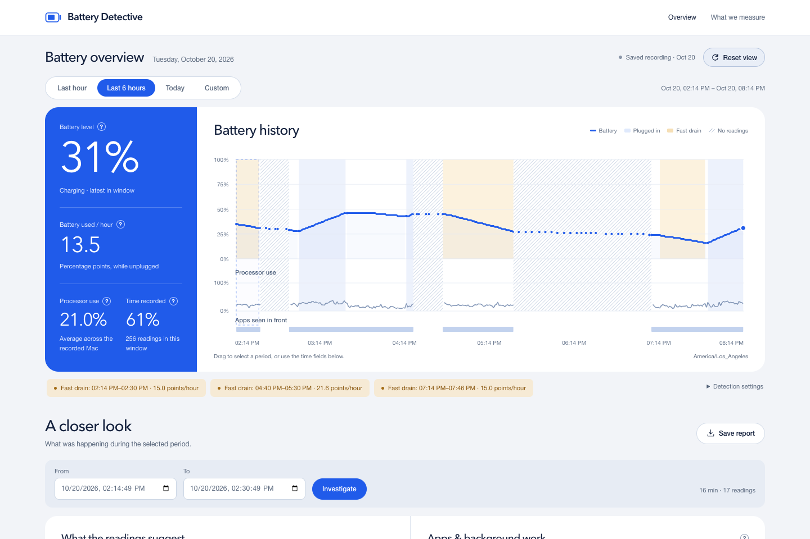

# Battery Detective

A macOS battery recorder and investigation dashboard built around one question: **“What was happening when my battery drained?”** Select a period to compare battery changes with recorded CPU and app activity, then save a report that separates measurements from possible explanations.

The [deployed demo](https://battery-detective.vercel.app) lets you explore a saved recording of battery and app activity from my MacBook; it does not collect data from your device.

[Product requirements](docs/prd.md) · [Measurements and architecture](docs/measurements.md) · [Validation](docs/validation.md) · [Setup and commands](docs/usage.md)



## What it does

- Records battery, system CPU, process activity, and the foreground app every 60 seconds by default.
- Aligns those observations on an interactive timeline with charging periods and gaps.
- Flags sustained fast drain and ranks possible contributors using recorded CPU work during valid unplugged intervals.
- Generates downloadable reports with evidence, limitations, and suggested comparison experiments.
- Keeps collection independent of the dashboard, with optional recording at login and explicit exports for sharing.

This is an exploratory prototype. Reports use deterministic calculations; optional AI explanations are described in the [roadmap](docs/prd.md#delivery-and-future-steps). CPU activity is evidence to investigate, not a measurement of an application's battery consumption.

## Run locally

Requires macOS and Python 3.11+. Collection has been exercised on an Apple Silicon MacBook Air; broader hardware validation remains open.

```sh
python3 -m venv .venv
source .venv/bin/activate
python -m pip install -e .
python -m battery_detective collect
```

In a second terminal, from the same checkout:

```sh
source .venv/bin/activate
python -m battery_detective dashboard
open http://127.0.0.1:8765
```

The first reading is immediate; CPU deltas appear after the next sample. Click **Refresh** for newer readings. Closing the browser leaves collection running; Ctrl-C in the collector terminal stops it.

To explore without collecting personal activity:

```sh
python -m battery_detective demo --db demo.sqlite
python -m battery_detective dashboard --db demo.sqlite --port 8766
```

The generated history is explicitly synthetic and includes known drain patterns, charging, and missing observations. See an [example report](examples/synthetic-investigation.md).

## Design choices

| Component | Approach |
| --- | --- |
| Collection | Python, `psutil`, and macOS AppKit through PyObjC; optional battery registry fields through `ioreg`. |
| Storage | SQLite with one transaction per sample, concurrent readers, and seven-day default retention. |
| Analysis | Conservative discharge calculations and configurable thresholds. Gaps, charging, and clock changes break continuity. |
| Interface | HTML, CSS, JavaScript, and SVG served by a local Python HTTP server. |
| Sharing | A separate Flask adapter serves an explicitly exported recording on Vercel using the same analysis code. |

Process identity includes both PID and start time to handle reused IDs. Unknown readings stay unknown, and partial measurement intervals are excluded instead of prorated. The [technical notes](docs/measurements.md) explain units, thresholds, baseline comparisons, and tradeoffs.

## Privacy and limits

Local history stays in `~/Library/Application Support/Battery Detective/telemetry.sqlite`. The local dashboard binds to loopback; collection requires no administrator access. There are no analytics, external frontend assets, or model API calls.

The collector does not read keystrokes, screenshots, window titles, document contents, browser history, command-line arguments, or environment variables. An explicit shared export contains app/process names, timestamps, and measurements from the selected interval; review it before publishing. Raw databases are excluded from this repository.

Sampling can miss brief activity. Rounded battery percentages limit precision, and the tool does not measure per-app energy or attribute display, GPU, network, and thermal power use. Controlled battery-impact trials and full hardware lifecycle testing remain future work.

## Verification and next steps

```sh
python -m pip install -e '.[dev,ui]'
python -m pytest -q
```

Tests cover measurement arithmetic, process identity, missing data, transactions, recorder lifecycle, report evidence, export boundaries, and dashboard interactions. Browser tests use an installed Brave Browser and skip when it is unavailable. [Validation notes](docs/validation.md) separate completed checks from remaining hardware experiments.

Next steps are controlled workload and recorder-overhead comparisons, sleep/wake and login-recovery validation, and usability testing. Optional AI explanations should consume verified findings, cite evidence, and preserve uncertainty.

Architectural reference: [OpenMacBattery](https://github.com/MuratDugan/openmacbattery), particularly its process identity, sampling, and storage design.
